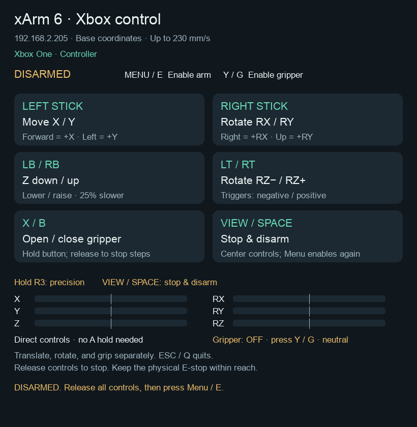
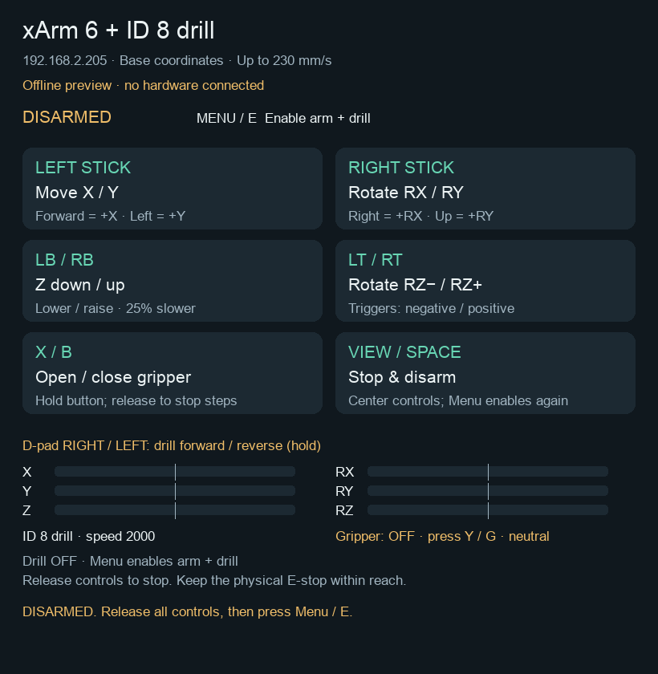

# xArm Xbox Teleop

Xbox controller jogging for a UFACTORY xArm 6, with a native macOS controller reader and a small Python control window. It uses the robot's mode-7 trajectory planner for continuous movement.

After enabling the arm, use the sticks and buttons directly—**no A hold is required**. X/Y movement is capped at 230 mm/s; Z is 25% slower, capped at 172.5 mm/s. The gripper opens and closes while X or B is held.



## xArm + SO-101 drill on one Xbox controller

Open **Start xArm + Drill.command** for the xArm 6 plus the standalone
STS3215 drill motor at **ID 8**. The entire SO-101 arm may stay connected on
the same USB bus: this mode addresses only ID 8 and leaves joint IDs 1–6
untouched, including their existing torque, positions, and calibration.
The existing **Start xArm Xbox.command** still controls only the xArm.

1. Run **Setup xArm Xbox.command** after updating to install the serial dependency
   and rebuild the native controller reader.
2. Connect the xArm by Ethernet and the SO-101 USB controller with the **ID 8
   drill** attached. Joint motors may remain connected. Stop/close other SO-101
   control applications, including the browser motor panel, before using Xbox.
3. Open **Start xArm + Drill.command**. It starts disarmed. Center the sticks,
   release all movement buttons and the D-pad, then press **Menu**.
4. Wait for **Drill ready**. Hold **D-pad right** for forward or **D-pad left**
   for reverse at the existing maximum setting of **2000 velocity units**.
   Release to stop the drill. Both D-pad buttons together also stop it.
5. **View / Space** stops and disarms both devices. **Y / G** enables the xArm
   gripper. The sticks, bumpers, triggers, X/B, and R3 keep their existing mappings.

The arm and drill can run together. Changing drill direction first commands
zero and pauses for 150 ms. R3 precision affects the arm, not drill speed.
This is a command setting, not a measured motor RPM.

The drill uses its own serial worker, checks input and window freshness, polls
motor communication/torque state, and stops if the arm disarms. Drill faults
also disarm the arm. Focus loss and controller reconnect require Menu again;
held D-pad input cannot start the drill during enable. The drill connection
requires a healthy motor at ID 8, never renumbers motors or commands joint IDs,
and claims exclusive USB access while active. A full process or host
failure cannot guarantee a drill stop: the servo's velocity mode has no
command expiry. Keep motor power and the arm's physical stop reachable.

Defaults: xArm `192.168.2.205`, drill `/dev/cu.usbmodem5C821107831`, ID `8`.
For another USB adapter path:

```sh
SO101_DRILL_PORT=/dev/cu.usbmodemYOUR_ADAPTER ./"Start xArm + Drill.command"
```

Read-only connection check (no torque, mode, ID, or motion writes):

```sh
./xarm-venv/bin/python xarm_xbox.py --check-drill --drill-port /dev/cu.usbmodem5C821107831
```

**Check Xbox Controller.command** also reads D-pad left/right without connecting
to either motor controller. The live UI shows the drill status and controls.
Offline tests cover both devices together; physical combined motion still
requires operator verification. The read-only drill check must find ID 8
before enabling the combined controls; other connected joint IDs are allowed.



## Setup on macOS

You need Python 3.12, Apple's Command Line Tools (`xcrun swiftc`), an Xbox controller recognized by macOS, and a network connection to the arm. The current adapter checks for a six-axis arm, firmware 2.5.0 or later, and the pinned SDK version.

```sh
git clone https://github.com/swaswa999/xarm-xbox-teleop.git
cd xarm-xbox-teleop
./"Setup xArm Xbox.command"
```

The setup script creates `xarm-venv`, installs the pinned dependencies, and compiles the controller reader. It does not connect to or move the robot.

Connect the controller over USB or Bluetooth, then open **Check Xbox Controller.command** to inspect inputs without connecting to the arm.

Open **Start xArm Xbox.command** to start teleoperation. The default robot address is `192.168.2.205`. To use a different address:

```sh
XARM_IP=192.168.2.123 ./"Start xArm Xbox.command"
# Or launch Python directly:
./xarm-venv/bin/python xarm_xbox.py --ip 192.168.2.123
```

Keep the control window focused. Startup checks connectivity and status and leaves the arm **DISARMED**. Center all motion controls, press **Menu** to enable the arm, and press **Y** to enable the gripper.

## Controls

All arm movements use base coordinates.

| Control | Action |
| --- | --- |
| Menu / keyboard E | Enable arm with motion controls centered |
| Y / keyboard G | Enable gripper |
| Left stick | X/Y: forward +X, left +Y |
| Right stick | RX/RY: right +RX, up +RY |
| LB / RB | Z− / Z+ |
| LT / RT | RZ− / RZ+ |
| Hold X / B | Open / close gripper |
| Hold R3 | Precision: 20% of the requested speed |
| View / Space | Stop and disarm |
| Escape / Q | Exit |
| A / L3 | Unassigned |

Center sticks and release motion buttons to stop. Normal move–release–move cycles do not require Menu again. Use translation, rotation, and gripper controls separately; conflicting groups stop movement.

Gripper speed is set to 1000, using one outstanding increment of at most 20 pulses. Releasing X/B prevents new increments; the current increment may finish. This is a speed setting, not a guaranteed measured travel rate.

## Stops and limits

This is an experimental operator-controlled application, not a safety-rated control system. Use it with a clear workspace, correct tool/payload configuration, and a reachable physical E-stop.

- Focus loss, disconnects, stale input or feedback, faults, and View/Space disarm control. Restoring focus or reconnecting does not automatically enable it.
- Startup does not home the arm or issue movement commands. Error clearing, collision settings, payload, and TCP offsets are not changed automatically.
- Mode 7 has no velocity-command expiry. Targets are bounded to 60 mm or an 8° orientation change from measured pose. If the host or network fails, the robot may finish its last target; these bounds are not emergency stopping distances.
- Only one local keyboard/Xbox control window may run at a time. Do not use Studio motion controls concurrently.
- C24 is the controller's speed-limit fault. Resolve it in Studio and review the pose/path before enabling again.

The separate keyboard launcher retains its own settings, including its higher requested arm speed. The Xbox speed caps above apply to `xarm_xbox.py`.

## Offline tests

All tests use fake robot objects; they do not operate a physical robot.

```sh
./xarm-venv/bin/python -m unittest test_xarm_xbox test_xarm_teleop test_so101_drill
```

The 112 tests cover direct control without A, direction mapping, bounded targets, speed caps, gripper feedback, release/resume transitions, startup feedback timing, watchdogs, and stop priority.

macOS native input and robot operation were exercised on the original workstation. Other platforms use SDL input and have not been physically validated here.

## Project files

- `xarm_xbox.py`: controller input, motion planning, feedback checks, and UI.
- `xarm_teleop.py`: shared connection/gripper helpers and the separate keyboard tool.
- `xbox-support/controller_bridge.swift`: read-only Apple GameController bridge.
- `test_xarm_*.py`, `test_so101_drill.py`: offline regression tests.
- `so101_drill.py`: standalone ID 8 serial driver and independent drill watchdog.
- `Xbox controls.txt`: detailed operating notes.
- `THIRD_PARTY_NOTICES.md`: source attribution and retained license notices.

For changes, run the offline tests before trying the input-only window. Physical motion testing must be performed by the operator.

## Attribution

The motion approach is adapted from [UFACTORY's teleoperation examples](https://github.com/xArm-Developer/ufactory_teleop). The upstream startup wrapper is not executed: this application provides its own explicit enable and stop handling.

The upstream BSD 3-Clause notice is retained in [LICENSES](LICENSES/ufactory-teleop-BSD-3-Clause.txt). See [THIRD_PARTY_NOTICES.md](THIRD_PARTY_NOTICES.md) for the reference revision and dependency details. This project is not an official UFACTORY product.
